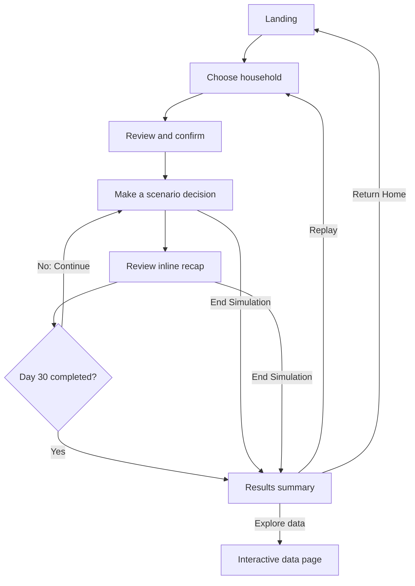
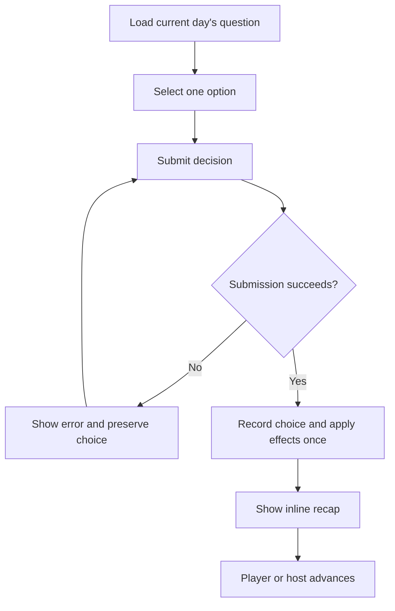

# CAC Poverty Simulation — User Flows

## Purpose and authority

This standing specification defines user journeys and state transitions for individual play, group play, data exploration, and CAC administration. Use [UI specification](./ui-spec.md) for screen structure and interactions. Agents can use both files without external images or conversation history. Financial calculations, content schemas, API contracts, and authorization are governed by the corresponding technical specifications.

## Roles

| Role | Responsibilities |
| --- | --- |
| Individual player | Set up an anonymous household run, make decisions, review results, replay |
| Group participant | Manage an independent household in a host-controlled session |
| Group host | Create a session, advance participants individually, end the session, facilitate comparison/debrief |
| CAC administrator | Authenticate and edit statistics and scenario questions |

## Individual journey

## Setup

1. Start simulation on the landing page opens household/persona selection directly. Until that screen is implemented, it opens the Individual simulation placeholder. No intermediate Introduction page is shown; the legacy introduction URL redirects to the individual route.
2. No household is selected by default. Select one approved profile to enable Continue.
3. Continue opens Review directly. CAC support is not a setup step for now: the client decided it will be offered as an option after players complete a regular run without it, and its design is a later task. Until then every run is without support (assistance choices are not offered).
4. Review displays the selected household, starting money, and its story, with a Change action that returns to household selection while preserving the choice. Review has no run-creation behavior until the protected start operation is connected; Confirm Selection reports that no run was created.
5. Confirm Selection initializes a fresh run in the pre-game stage with the selected persona, the run's support setting (currently without support), and approved published `version_id`. The run's weekly income starts at $0; changing employment and income state is run-specific.
6. Once started, the player cannot inspect or edit setup. The active run offers End Simulation rather than Back to Review.

Setup Back actions preserve choices. Changing a household before confirmation uses that household's starting values when the run is initialized; it does not create a financial transaction.

## Pre-game employment sequence

Before Day 1, show approved job options the persona qualifies for, their weekly incomes, and (when CAC is enabled) approved preparation choices. Preparation is recorded explicitly and does not itself grant assistance or employment. Show the pre-game result and the general fact, plus the CAC fact in CAC mode, before Day 1.

On Day 2, offer the approved professional-clothing choices. The specified preparation-and-clothing combinations determine the first interview result; purchased or CAC-provided professional clothing becomes run state and is not charged again. After a failure, prompt the player to reapply for a lower-requirement job without skipping the Day 2 result. On Day 3, if required by the route, reuse owned professional clothing and show only the applicable clothing choice; the player gets the lower-requirement job regardless of the available clothing selection. The job catalog and preparation details remain unresolved; see [scenarios.md](../docs/scenarios.md).

After hiring, weekly income is paid seven days after the hiring day, not immediately. On an income due day, show a brief income notification and apply the credit before presenting scenarios. The tax-filing scenario is non-scheduled: “Try my best” has no refund or deduction; CAC assistance gives the specified $1,000 refund immediately; and the paid-preparer choice first checks whether the player can afford the fee. If not, end the run before applying any fee or refund consequence. The preparer fee amount remains unresolved.

## Daily decision and recap

1. Display the current day, available balance, upcoming expenses, scenario, and applicable decision options.
2. Selecting an option updates selection only. It does not change money or response counts.
3. Submit Decision records the option under its question and applies the approved financial/situational effects exactly once. Block repeated commits from clicks, retries, or refreshes.
4. Show the inline recap beneath the cards, preserving the selected option. Include immediate consequence, financial breakdown, projected balance after upcoming expenses, and circumstance changes.
5. Submitted choices become read-only. Include an approved question-linked comparison when available.
6. Individual players select Continue Simulation after reviewing the recap. Multiple decisions may occur on the same day; completing a question does not inherently advance the calendar. Advance only after required same-day events and recaps are handled. Advancing does not reapply the previous choice.
7. Completion of the Day 30 question leads to the results summary after its recap. The day counter remains within the 30-day month.

The UI consumes balances, scheduled income, end-of-day scenarios, and consequences from the simulation model. Upcoming-expense projections are separate from actual deductions. Automatic income is credited in a brief notification before that day's scenarios; scheduled and non-scheduled scenarios use the same scenario interaction flow. An attempted unaffordable optional choice or an unaffordable/missed required payment ends the run without recording an unaffordable charge. Do not use player identity to calculate finances or introduce new financial policies in the frontend. Normal completion is Day 30; players can also choose End Simulation.

## CAC support

Store the support setting at confirmation and keep it fixed for the run. With support, relevant questions offer assistance options, such as visiting the CAC market when food is low. Without support, those options are excluded. Availability is separate from actual use, and assistance is capped to the eligible remaining expense.

Assistance affects the household only when its corresponding choice is submitted. Apply the scenario's approved assistance effect; choosing support during setup alone does not grant a benefit. Track actual use separately from availability. The ending summary can therefore distinguish support disabled, available but unused, and used.

## Anonymous persistence and refresh

Use an anonymous run identifier rather than a name, email, or player account. Save enough state to restore the run in the same browser: household, support setting, content version, current day/question, financial and circumstance state, submitted decisions, and whether a recap is being displayed.

On refresh, restore the latest committed state. A committed decision returns to its recap without another deduction or response count. A completed or ended run returns to its results. An active group participant reconnects to the same group and participant state. Refresh must not create a new run or reset progress.

## Ending and replay

| Trigger | Result |
| --- | --- |
| Day 30 question completed | Full results with 30 days completed |
| Player selects End Simulation | Partial results with actual progress and completed decisions |
| Host ends the group early | Each participant receives results for their completed work |

An ended run no longer accepts decisions. Partial summaries must be labeled as early endings and must not imply the player completed the month. Include balance, decisions/consequences, support availability/use, and applicable comparisons. Unanswered questions have no invented choices or outcomes.

Replay returns to household selection with no household selected. The player chooses a household and support setting again, reviews, and confirms. A new run uses the saved content available when it starts and resets finances, day, expense state, circumstances, and decision history. Preserve the previous run as a separate result rather than overwriting its response records.

Return Home opens the landing page. Donate to CAC and Visit CAC Site use configured CAC-approved links. View Data Visualization opens a separate interactive data page.

## Comparison and data exploration

After a decision, retrieve approved statistics associated with its question. Show value, unit, geography, data period, and source. Keep these separate from the player's choice and anonymous response aggregates.

Anonymous response counts or percentages must relate to the correct question and be labeled as simulation responses, not representative community research. Missing statistics or zero responses produce an unavailable-data state and do not block gameplay.

View Data Visualization opens a separate interactive page with four measures: decision distribution, ending balance distribution, CAC support use, and community context. Use the chart definitions and color tokens in the UI specification.

1. Initialize the household filter to the current run's household and show both CAC support settings for applicable comparisons. Initialize question-based views to an answered question.
2. Changing Household narrows decision/support-use results; ending balances always compare one household at a time.
3. Changing CAC support setting filters decision results or shows ending-balance support groups separately. The support-use measure always calculates usage among support-enabled completed runs.
4. Changing Question selects the decision distribution and its linked community context. Do not show this filter for aggregate ending-balance or support-use views.
5. Update eligible counts, percentages, and chart labels with every filter change. Offer a reset action. Controls change the view only; they never modify the run.
6. For each question, include committed responses from completed and early-ended runs. Count one response per run and use the filtered question response count as the percentage denominator.
7. For ending balances, use only completed Day 30 runs of the selected household, separating support settings. For support use, count completed support-enabled runs with at least one assistance choice against all eligible completed support-enabled runs. Show sample sizes for each measure/group.
8. Keep community statistics separately sourced and labeled. Aggregate only compatible content definitions; do not mix changed option meanings or different household financial configurations as equivalent data.
9. Label group-session comparisons as current-session results and public comparisons as anonymous player results. Show a clear empty state when no eligible data exists.
10. Provide navigation back to results and home; neither action changes saved decisions.

## Group journey

1. The host selects Host a Group, creates a session, and receives a shareable join code.
2. Participants select Join a Group and enter the code. Validate the session and show a readable error for invalid codes.
3. Each participant completes household/support setup and confirmation. Each has independent money, choices, and circumstances; there is no shared household balance.
4. The host controls advancement for each participant individually. A participant submits the current decision and reviews the recap; host advancement moves that participant to the next day's question. Do not substitute a vote or another participant's choice for their decision.
5. The host can inspect participant progress and continue facilitating while participants complete their own runs.
6. A participant finishing Day 30 sees their own summary and can recap while others continue.
7. The host may end the game early. Stop further submissions for the ended session and show each participant a full or partial summary based on their actual progress.
8. At the end, compare participant results and support a group debrief. Preserve separate household states and label partial runs accurately.

Host advancement must not count an unanswered question as a completed decision or invent a participant's answer. Keep participant/session state through refresh. Individual completion and a session-wide end are distinct events.

## Employee administration

1. Employee Admin opens staff sign-in. Enter work email and password, then Sign In.
2. Authenticate through Supabase Auth and verify CAC staff authorization. Failed authentication or denied authorization keeps protected content inaccessible.
3. Open the dashboard and choose Statistics or Scenario Questions. Scenario work is organized by the six approved categories, edition-scoped persona/category and scenario/persona applicability, and explicit service coverage.
4. Inspect the record and its related display locations, status, and last-updated information.
5. Edit either content type. Statistics preserve their source/context and question associations. Question changes preserve valid choice and scenario relationships.
6. Save validated edits as pending draft content. Show success only after persistence succeeds; on failure retain edits and display an error. Generation requests produce one scenario and allow at most three total model attempts.
7. Staff approve and publish a complete immutable edition through a protected operation. New simulations use it; active simulations retain the starting `version_id`, including after refresh. Keep content referenced by existing runs accessible according to the data model.
8. Main Site returns to the public site. Sign Out ends authentication and prevents subsequent protected access.

Staff authentication does not require player authentication. Public players remain anonymous.

## Errors and recovery

| Condition | Behavior |
| --- | --- |
| Missing household/support choice | Keep Continue unavailable; identify the required selection |
| Required content retrieval fails | Show Retry and prevent advancement using incomplete content |
| Decision submission fails | Preserve selection, show error, and do not display a successful recap |
| Repeated submission or restored recap | Reuse committed result; do not repeat effects or response counts |
| Comparison data is missing | Show unavailable state or omit comparison; continue gameplay |
| Browser refresh | Restore the existing run and its current screen state |
| Invalid group code | Explain failure and allow correction |
| Group session ended | Show applicable results; disallow further submission |
| Unauthorized staff access | Keep protected records inaccessible and show readable feedback |
| Admin save fails | Retain edits and do not apply them to newly started simulations |

## Verification criteria

Verify setup validation, Review edits and confirmation, immutable active setup, pre-game employment flow, support opportunities and capped use tracking, same-day decisions, scheduled income, refresh recovery, duplicate-safe submission, required-event early endings, Day 30 summaries, replay through new setup, separate interactive data exploration, individual host advancement, independent group finances, participant recaps, early host termination, staff authorization, pending-edition approval, and version isolation for existing runs. Verify keyboard navigation and responsive layouts as specified in the UI file.
