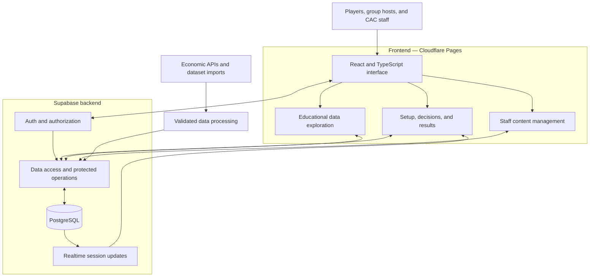

# System Architecture — CAC Poverty Exercise

## 1. Purpose and scope

The CAC Poverty Exercise is an educational web application developed by Georgia Tech Team 6310 for the Community Assistance Center (CAC) in Sandy Springs, Georgia. Participants navigate a pre-game stage followed by Days 1–30 and make decisions involving approved scenario categories, housing, food, employment, and unexpected expenses. Multiple decisions may occur on one day. The experience demonstrates financial trade-offs and connects simulated outcomes with community statistics and CAC resources.

Sprint 1 prioritizes the individual simulation. The broader application also includes facilitated group play, interactive data exploration, and an administrative portal for authorized CAC employees.

This document describes the application's intended architecture. The repository contains React Router navigation, labeled placeholder pages, a shared navigation layout, development tooling, a Supabase client module, and Supabase configuration. The admin dashboard route redirects to sign-in until authentication and staff authorization are integrated. Route tests cover placeholder entry, navigation/history, keyboard focus, and this closed boundary; they do not establish database security. The individual placeholder can explicitly prepare an anonymous participant Auth session through the centralized client; it creates no run or application data. Hosted Auth configuration and live verification remain pending. The initial migration file is empty. Simulation features and database protections described below remain implementation requirements.

## 2. Architecture and rationale

The application uses a client-server architecture. React provides the browser interface, Supabase provides backend services, and PostgreSQL stores application data. Cloudflare Pages is the selected frontend hosting platform.

| Component | Technology | Responsibility |
| --- | --- | --- |
| Browser interface | React 19 and TypeScript | Screens, navigation, temporary selections, accessible controls, and presentation of simulation results |
| Frontend development and build | Vite 8 | Local development server and production assets |
| Backend services | Supabase | Data access and protected application operations |
| Persistent storage | PostgreSQL through Supabase | Household content, scenarios, statistics, playthroughs, responses, sessions, and content versions |
| Session identity and staff sign-in | Supabase Auth | Anonymous player/host sessions and employee authentication |
| Group updates | Supabase Realtime | Distribute authorized session and participant updates |
| Frontend hosting | Cloudflare Pages | Serve the built web application |
| Verification | Vitest, React Testing Library, ESLint, Prettier, TypeScript | Behavior tests, linting, formatting, type checking, and build checks |

React supports reusable interface components across setup, decisions, recaps, and results. TypeScript provides shared typed interfaces for application data. Supabase brings database access, authentication, and realtime services into the selected backend platform. PostgreSQL supports the relationships between content, choices, recorded decisions, and financial state. Separating interface state from protected operations prevents browser-controlled values from determining authoritative outcomes.

### Static system structure

The diagram shows component responsibilities and communication boundaries, rather than a deployed infrastructure inventory.

## 3. Frontend responsibilities

### Implemented foundation

A development-only `/dev/integration-test` route can prepare an anonymous session
and insert a test message through the centralized client. The separate
`20261025000000_integration_test.sql` migration defines only a temporary owned-row
table and restrictive anonymous-participant policies; it is not applied
automatically or part of the simulation schema. Live database enforcement remains
unverified until the [manual checks](integration-test.md) are performed.

`frontend/src/app/` defines React Router paths and a dashboard boundary that currently redirects all access to sign-in. `pages/` separates public, individual, group, and admin placeholders; `layouts/` provides the shared shell. `components/ui/` provides reusable controls using specification tokens and locally bundled Roboto. Prototype layout sources are documented in [Prototype reference](../design/prototype-reference.md).

`types/domain.ts` defines initial readonly frontend read models, including branded safe integer USD cents. These are not finalized database DTOs. `state/simulationState.ts` keeps temporary choices separate from a committed service snapshot; it performs no balance calculations, response commits, or calendar advancement. `hooks/useSimulation.ts` supports explicit restoration and ignores stale responses. `services/simulationService.ts` defines an unconnected contract whose default implementation rejects operations. `services/supabase.ts` lazily accesses the existing client so placeholder routes do not require credentials. No prototype fixtures or browser-storage financial logic are used by the frontend.

Backend response validation, ownership, eligibility, edition validation, atomic commitment, idempotency, results retention, and database authorization remain future feature work. Component and reducer tests establish frontend scaffolding behavior only; native dialog browser behavior, responsive visual rendering, deployed deep links, and backend security require their own verification.

### Individual simulation

Setup proceeds through Introduction, Household, CAC Support, and Review. Household and support selections are explicit. Review allows edits before confirmation; confirmation starts a new run at Day 1 and locks those settings.

The decision screen displays the current day, balance, upcoming expenses, scenario, and applicable choices. Selecting an option changes temporary interface state only. Submitting records the decision and applies its approved consequences once. Scheduled scenarios and income occurrences use one authoritative, idempotent charge/credit path. A required payable event that cannot be paid ends the run with its actual day and reason. The interface displays a successful inline recap only after commitment succeeds.

The recap shows balance before, cost today, balance after, projected balance after upcoming expenses, and circumstance changes. Projected expenses remain distinct from deductions already applied. Individual players continue after the recap; completing a question does not inherently advance the calendar, so same-day decisions and required events are processed before advancing. Normal completion follows Day 30. End Simulation and inability to pay produce clearly labeled partial summaries. Replay returns to household selection and creates a separate run with fresh state.

CAC support availability and actual assistance use are separate. Enabling support during setup allows relevant assistance choices; it does not automatically grant financial benefits.

### Group simulation

Hosts create sessions with join codes. Participants join and complete their own household/support setup. Each participant maintains an independent balance, decision history, and circumstances. Hosts advance participants individually after decisions and recaps, inspect progress, and can end the session. Group comparisons distinguish completed and partial runs. Supabase Realtime distributes authorized updates while the backend enforces session ownership and membership.

### Educational comparisons and CAC information

The interface shows approved question-linked community statistics and a separate interactive data page. Its measures include decision distributions, ending-balance distributions, CAC support use, and community context. Population statistics and simulation response aggregates have separate labels and sources. Charts use the populations, filters, and denominators defined in the UI specification. Missing comparisons do not prevent gameplay.

Public navigation and results provide client-approved CAC information and donation links. The application does not process donation payments.

### Employee administration

CAC employees sign in using Supabase Auth and must also have staff authorization. The portal supports editing statistics and scenario questions, validates changes, and reports save success only after persistence. New runs use newly saved content; active runs retain their original content version. Sign-out ends protected access.

Interface details, theme tokens, accessibility, loading states, and error behavior are specified in [UI specification](../design/ui-spec.md) and [User flows](../design/user-flows.md).

## 4. Backend and persistence responsibilities

The frontend accesses Supabase through the JavaScript client. Protected backend operations validate ownership, current run state, scenario/choice relationships, CAC support eligibility, and content-version consistency.

Decision commitment calculates consequences from trusted content and updates responses, finances, and progress atomically. Duplicate clicks, retries, and refreshes must not repeat financial effects or response counts. Ended runs and sessions reject further decisions. Same-browser refresh restores committed state, including recaps and results, rather than starting a new run.

The documented application entities are:

| Area | Entities | Purpose |
| --- | --- | --- |
| Simulation content | `categories`, `personas`, `persona_categories`, `scenarios`, `scenario_personas`, `service_coverage`, `choices`, `cac_support_effects` | Edition-scoped route coverage, household definitions, scenarios, decisions, and assistance effects |
| Educational statistics | `statistics`, `scenario_statistics` | Source-backed figures and links to relevant scenarios |
| Gameplay records | `playthroughs`, `playthrough_expenses`, `player_responses` | Run state, bill occurrences, and committed decisions |
| Group coordination | `group_sessions` | Facilitated sessions and participant association |
| Content history | `content_versions`, `scenario_generation_requests`, `source_bindings` | Immutable published editions, pending drafts, generation review, and resolved-cost provenance |

Individual playthroughs have no group association; group playthroughs reference their session. Scenarios belong to content versions. Supabase supplies `auth.users` separately from the application entities. Detailed fields and relationships are defined in [Data model](data-model.md); proposed SQL types and constraints there remain proposals rather than an implemented schema.

## 5. External data boundary

[External data and API integration](api.md) identifies Census ACS, HUD Fair Market Rents and Income Limits, BLS occupational wage data, USDA food plans, EIA electricity prices, FRED price indices, FINRA survey data, and CAC-provided community information as intended sources. Monthly checks run at the first midnight in `America/New_York`; refreshes are staged for staff approval.

The data-processing boundary accommodates API retrieval and reviewed dataset imports. It validates inputs and preserves source, units, geography, reporting period, and retrieval/import context. Simulation content references approved economic values, and application rules define their financial effects. External API credentials remain outside browser code.

Community figures provide educational context; simulation aggregates describe recorded runs and responses. Replays do not represent unique people. Data updates preserve reproducible outcomes for existing runs.

## 6. Security and privacy

[Security and privacy](security.md) governs the application's access boundaries:

- Players and hosts use internal Supabase anonymous sessions without entering names, email addresses, or passwords. Staff authentication and authorization are separate capabilities.
- Row Level Security and minimal grants protect every table exposed through the Data API. Private run access requires verified ownership; group controls require verified host authority.
- Protected operations calculate financial effects from trusted content rather than client-supplied balances or costs.
- The browser may contain the Supabase URL and publishable key. Service-role keys, database credentials, and external API secrets remain server-side.
- Public comparison payloads contain aggregates only. Public filtered cohorts smaller than five eligible runs/responses are suppressed as specified in the security document.
- The application uses fictional finances and does not collect participants' real household financial information. Content changes preserve historical references and record staff actions.

These protections apply to database/API calls and realtime subscriptions as well as visible interface controls.

## 7. Development and verification

The frontend uses Node.js 24 and the committed npm lockfile. `frontend/.env.example` defines `VITE_SUPABASE_URL` and `VITE_SUPABASE_PUBLISHABLE_KEY`; `frontend/src/lib/supabaseClient.ts` creates the client and rejects missing values when the module is loaded.

The Frontend CI workflow at `.github/workflows/ci.yml` runs on pushes and pull requests. It installs dependencies with `npm ci`, checks formatting, runs ESLint and TypeScript checks, executes tests, and builds production assets. Current tests cover routing placeholders, shared controls, and UI state/service scaffolding; gameplay and backend tests must be added alongside implementation. CI configuration alone does not establish that a particular run passed.

Agent workflow and verification commands are defined in the root [AGENTS.md](../AGENTS.md).

## 8. Related specifications

- [Data model](data-model.md): entities, relationships, and database design.
- [External data and API integration](api.md): data sources and processing boundaries.
- [Security and privacy](security.md): authentication, authorization, privacy, and protected operations.
- [UI specification](../design/ui-spec.md): screens, presentation, accessibility, and chart definitions.
- [User flows](../design/user-flows.md): setup, gameplay, recovery, group, and staff journeys.
- [Agent instructions](../AGENTS.md): development process and verification requirements.
