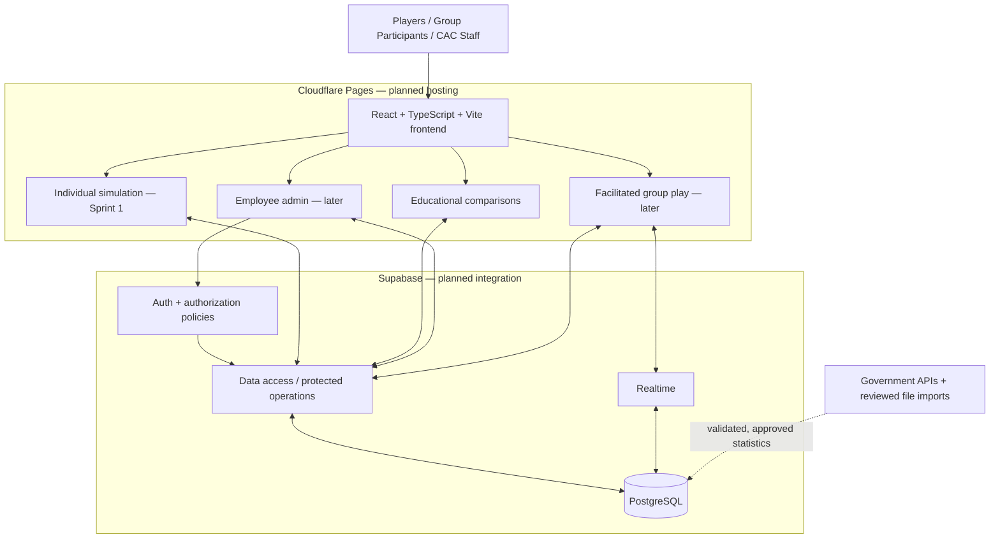

# System Architecture — CAC Poverty Exercise

## 1. Purpose and status

The CAC Poverty Exercise is a web application for the Community Assistance Center in Sandy Springs, Georgia. Players navigate a fictional household's 30-day month, choose how to respond to financial challenges, and see consequences and educational comparisons. The planned product also includes facilitated group play and CAC employee content administration.

**Implementation status:** The repository currently contains a React/TypeScript/Vite frontend scaffold and its tooling. The supplied `frontend/src/App.tsx` still renders a starter counter, and its existing test tests that counter. The documented simulation, Supabase-backed data model, group play, and administration are **planned**, not verified as implemented. Sprint 1 prioritizes the individual simulation; group and administration are later scope. Do not interpret a prototype screen or an installed dependency as implemented functionality.

## 2. Architecture and technology stack

The planned design is a client–server web application with a hosted frontend, Supabase services, and a PostgreSQL database.

| Layer | Technology | Responsibility | Status |
| --- | --- | --- | --- |
| Frontend | React 19, TypeScript, Vite 8 | Pages, selection state, accessible interactions, rendering simulation results | Scaffold present |
| Backend/data access | Supabase; `@supabase/supabase-js` | Data operations and service access | Client dependency installed; integration not verified |
| Persistent data | Supabase PostgreSQL | Content, versions, playthroughs, responses, sessions, statistics | Documented design; no migrations supplied |
| Staff identity | Supabase Auth | Authenticate CAC employees; authorization must be enforced separately | Planned |
| Group updates | Supabase Realtime | Distribute facilitated-session updates | Planned, later scope |
| Hosting | Cloudflare Pages | Deploy frontend | Planned; deployment configuration not supplied |
| Public data | Official APIs and controlled dataset imports | Approved economic inputs and contextual statistics | Source strategy documented; integrations not verified |
| Development checks | Vitest, React Testing Library, ESLint, Prettier, TypeScript, Vite | Test, lint, format, typecheck, build | Configured in `frontend/package.json` |

The dotted data-source arrow describes the **intended** ingestion path, not a deployed direct connection to PostgreSQL. A controlled import or server-side integration will mediate retrieval, validation, storage, and approval.

## 3. Component responsibilities

### Frontend

The public interface includes landing, introduction, household selection, CAC support selection, review, scenario decision, inline decision recap, and ending summary. The four-step setup is **Introduction → Household → CAC Support → Review**. Players do not require sign-in. See `docs/design/ui-spec.md` and `docs/design/user-flows.md` for the exact screen states and navigation.

- **Individual simulation (Sprint 1):** Show approved persona content, available choices, balances, day/progress, and upcoming expenses. Selecting a choice does not change finances; submitting it records a decision and applies approved consequences once. Show the committed result in an inline recap before continuing. CAC support availability is separate from actual assistance use.
- **Educational comparisons:** Show approved statistics linked to scenarios, with value, unit, geography, reporting period, and source. Clearly distinguish population statistics from anonymous player response aggregates. Missing comparisons must not block gameplay.
- **Group simulation (later):** Host/join with a session code, timed rounds, response collection, and aggregate debrief. Precise host controls, timers, and participant state remain unspecified.
- **Employee administration (later):** Staff sign-in, content review/edit/publish, statistics management, and session administration. Staff access requires authorization, not merely a successful login.
- **CAC information:** Public Learn About CAC and Donate actions use client-approved destinations.

The frontend must not invent simulation financial rules or treat illustrative prototype values as production content.

### Supabase services and business rules

Supabase is the selected service boundary for persistent data access, staff authentication, and future realtime group coordination. Privileged operations must be authorized and validated outside browser-only checks. The design calls for duplicate-safe decision submissions, consistent financial state changes, controlled publication, and protection of active playthroughs from later content updates.

**Unresolved implementation boundary:** The documents do not yet choose between PostgreSQL functions, Supabase Edge Functions, and other approved server-side mechanisms for authoritative financial calculations, idempotent submissions, publication, and timed group rounds. That decision must be approved before implementing those operations; an agent must not select it unilaterally.

### PostgreSQL data model

`docs/data-model.md` documents **12 proposed application entities**:

- **Content:** `personas`, `persona_expenses`, `scenarios`, `choices`, `cac_support_effects`, `content_versions`.
- **Statistics:** `statistics`, `scenario_statistics`.
- **Activity:** `playthroughs`, `playthrough_expenses`, `player_responses`, `group_sessions`.

Supabase `auth.users` is an external identity reference for authorized staff, not one of the 12 application tables. The data-model document distinguishes specified fields from proposed PostgreSQL types and constraints; it is **not** a migration or verified deployed schema. Preserve source-to-choice links, version consistency, and the separation between active runs and later published content.

## 4. Main interactions

**Individual play (Sprint 1):** Landing → Introduction → Household → CAC Support → Review → initialize playthrough → load scenario → select choice → submit once → persist approved effect and response → show inline recap and optional comparison → continue to next scenario → Day 30 summary. A failed submission retains the selection and does not show a successful recap. Replay must create fresh run state rather than carry over previous balances or responses.

**Facilitated play (later):** Facilitator creates a session/code → participants join → facilitator advances rounds → participants submit timed choices → backend records valid responses → Realtime distributes updates → facilitator displays aggregated results. Exact timing, session ownership, reconnection, and shared-versus-individual finances require approval before implementation.

**Administration (later):** Staff signs in → authorization is checked → staff reviews or edits content → changes are validated → approved content is published. Existing playthroughs must not silently switch to newly published assumptions. Editing and deletion semantics remain subject to the content-version design.

## 5. External data and AI-assisted content

`docs/api.md` identifies specific researched sources and their intended access methods:

| Source | Intended approach | Example purpose |
| --- | --- | --- |
| Census ACS 5-year | JSON REST API | Income, poverty, housing and demographics |
| HUD Fair Market Rents / Income Limits | HUD API or downloadable data | Rent benchmarks and assistance eligibility context |
| BLS OEWS | Initially downloaded tables; API only if suitable | Occupation- and geography-specific wages |
| USDA Food Plans | Controlled spreadsheet/report import | Monthly food-budget estimates |
| EIA electricity data | JSON REST API | Georgia residential electricity price context |
| FRED food/beverage CPI | REST API | Atlanta-area price-index trends |
| FINRA NFCS | Controlled survey dataset import | Financial capability comparisons |
| CAC community resources | Client-provided data; format unconfirmed | Local assistance information |

Data must be validated and retain provenance, geography, period, units, and retrieval/import metadata. API keys must not be embedded in the browser bundle. Data refreshes should follow source publication cycles and a review/approval process; the schedules in `docs/api.md` are **proposals**, not running jobs. The application should reference approved economic inputs rather than allow AI-generated text to determine authoritative prices, formulas, or balances. AI-assisted scenario creation is planned for administrative review, not automatic publication.

## 6. Security, privacy, and deployment

Public players are anonymous; CAC staff use Supabase Auth and separate authorization controls. Enforce database permissions (including appropriate Row Level Security), protect service-role credentials, validate protected writes, and display aggregated group responses. Do not infer real-world demographic characteristics from players' simulated choices. See `docs/security.md` **if present** for the full security policy; that file was not among the supplied uploads.

The frontend is planned for Cloudflare Pages. The supplied repository screenshot shows `.github/workflows/`, and a commit message indicates a frontend CI workflow, but the workflow file itself was not supplied. Do not claim particular CI checks or successful deployments without inspecting the workflow and its run results.

From the `frontend/` directory, the configured npm scripts are `dev`, `test`, `lint`, `format:check`, `typecheck`, and `build`. Detailed commands and agent expectations are in the root `AGENTS.md`.

## 7. Decisions that genuinely remain open

These are documented gaps, not instructions for an agent to improvise:

1. **Simulation engine:** Authoritative execution mechanism; money/sign rules, day progression, scheduled expenses, insufficient funds, endings, and replay/version behavior.
2. **Database readiness:** Resolve the version and relationship inconsistencies identified as I1–I3 and I5 in `docs/data-model.md`, along with types, nullability, ownership, and RLS before migrations.
3. **UI specifics:** Final Review screen, Back to Review behavior, setup defaults, CAC color tokens, and selected summary/chart metrics.
4. **Later-sprint workflows:** Group session timing/ownership/reconnection and admin editing/publishing/deletion rules.
5. **Data operations:** Exact dataset variables/geographies, transformations, storage and cache strategy, approval process, and client-provided resource format.
6. **Infrastructure:** Confirm deployed Supabase environments, migration process, Cloudflare deployment settings, and actual CI workflow checks.

Record approvals in the relevant specification before implementation. See `docs/data-model.md`, `docs/api.md`, `docs/design/ui-spec.md`, and `docs/design/user-flows.md` for detailed open issues.

## 8. Related specifications

- `docs/data-model.md` — entities, fields, relationships, constraints, and unresolved schema issues.
- `docs/api.md` — external sources, import/API strategy, provenance, and data-update questions.
- `docs/design/ui-spec.md` — screens, interface behavior, accessibility, and Figma reference.
- `docs/design/user-flows.md` — player, group, and staff journeys and state transitions.
- `docs/security.md` — security/privacy specification **if the team has created it**.
- Root `AGENTS.md` — instructions for coding agents and development verification.
