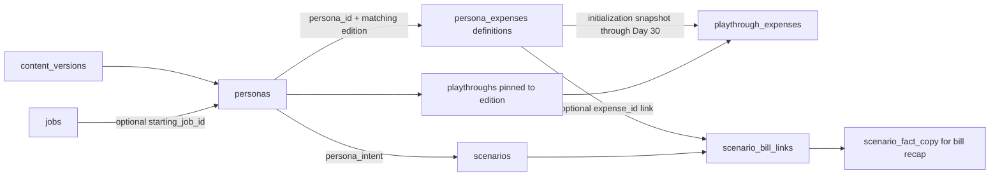

# CMS Persona Editor design — November 17, 2026

**Status: Stages 1 and 2 implemented locally; expense editing remains Stage 3.**
Persona details now use the existing draft-only CMS workspace, protected bundle
persistence and staff boundary. Expense definitions are shown read-only and retained
unchanged. No expense management, appearance customization, publication or gameplay
changes are included. The design below records the investigation and approved
architecture; the implementation records describe completed stages.

## Evidence and scope

Verified against repository code and read-only PostgreSQL catalog inspection of
`supabase_db_team6310-phase2-verification` on November 17. Inspection covered
columns/defaults, generated columns, constraints, foreign keys, triggers, policies,
function bodies and table grants. No hosted database was contacted. Local findings
do not certify hosted schema equivalence or deployment.

Key sources:

- [CMS persistence](cms-persistence.md), [roadmap](cms-roadmap.md),
  [Stage 1 contract](cms-stage1.md), [bill rules](bills-system.md).
- [CMS workspace/copy contract](../supabase/migrations/20261117020650_cms_scenario_workspace.sql),
  [atomic scenario/choice saves](../supabase/migrations/20261117152243_cms_scenario_choices.sql),
  [scenario fact saves](../supabase/migrations/20261117203330_cms_scenario_facts.sql),
  [draft deletion](../supabase/migrations/20261117155926_cms_draft_deletion.sql).
- [Bill definitions and snapshots](../supabase/migrations/20261108010000_bill_schedule_foundation.sql),
  [bill operations and collisions](../supabase/migrations/20261108020000_bill_gameplay.sql),
  [financial snapshot](../supabase/migrations/20261108030000_bill_financial_snapshot.sql).
- [Viewer](../frontend/src/pages/admin/dashboard/PersonasPanel.tsx),
  [viewer loader](../frontend/src/services/adminContent.ts),
  [game content loader](../frontend/src/services/contentService.ts),
  [employment processing](../supabase/migrations/20261103000000_employment_gameplay.sql).

Some standing architecture/data-model text describes intended tables or older
read-only CMS behavior. Actual catalog and current code take precedence for this
proposal; historical migrations must not be replayed to reconstruct the baseline.

## Verified schema and relationships



The diagram's matching-edition label is partly enforced by protected operations
and triggers, not universally by composite foreign keys.

- `personas` has a UUID primary key and an edition FK. `starting_job_id` optionally
  references `jobs`. `scenarios.persona_intent` references one persona; general
  scenarios have no persona. No multi-persona scenario association is introduced.
- `persona_expenses` has its own UUID primary key; each row belongs to exactly one
  persona and edition. Definitions are not shared across personas. Equal names do
  not imply shared identity. The persona FK cascades on persona deletion; the
  bill trigger additionally requires matching persona/edition on insert/update.
- Persona inbound FKs also include `playthroughs`, `group_participants`, and
  `group_sessions.selected_persona_id`. Some inherited FKs cascade; this is a
  reason to avoid unrestricted persona deletion, not permission to cascade history.
- Expense inbound FKs are `playthrough_expenses(expense_id,version_id)` and
  `scenario_bill_links.expense_id`. The link's primary key is expense_id: one
  expense can link to one recap scenario, while multiple expenses can link to the
  same scenario. Individual link FKs do not alone enforce edition consistency.
- `persona_categories` and `scenario_personas` are absent locally, despite older
  specification proposals. There is no stored persona enabled/selectable flag,
  avatar field, monthly budget total, or structured age/dependents field.

### Persona field inventory

These are all nine current columns. **Editable** below is a recommendation, not
an existing capability. No persona column is PostgreSQL-generated; only persona_id
has a `gen_random_uuid()` default. There is no persona total/income calculation trigger.

| Field                      | Verified meaning/consumption                                                                       | Recommended CMS handling                                                                                                                         |
| -------------------------- | -------------------------------------------------------------------------------------------------- | ------------------------------------------------------------------------------------------------------------------------------------------------ |
| `persona_id`               | UUID identity used by scenarios, expenses, runs and groups                                         | Read-only technical detail; server generates new IDs; preserve existing draft IDs                                                                |
| `version_id`               | Edition identity; nullable in inherited schema                                                     | Read-only; server derives from selected CMS workspace and requires it                                                                            |
| `name`                     | Required text; viewer, household selection and group display                                       | Editable, trimmed and nonblank; also show avatar preview                                                                                         |
| `description`              | Nullable text in schema; household loader requires nonblank text                                   | Editable narrative; require nonblank for newly authored personas; flag incomplete copied content rather than silently invent text                |
| `general_starting_balance` | Nullable numeric; individual start RPC seeds current_balance, group selection seeds shared_balance | Editable **content definition**, exact USD; explicitly required for new personas; recommend finite nonnegative cents; never update existing runs |
| `weekly_income`            | Nullable numeric; household loader accepts null as zero and rejects nonzero                        | Read-only; new personas get 0; preserve copied values and show incompatibility warning for nonzero legacy values                                 |
| `starting_job_id`          | Optional jobs FK; household loader rejects a non-null starting job                                 | Read-only, normally None; new personas get NULL; preserve legacy links without a job picker or silent normalization                              |
| `has_english_skills`       | Nullable boolean; individual employment begin requires a boolean and seeds run skills              | Editable explicit Yes/No; copied NULL shown as Not configured, never coerced to false                                                            |
| `has_computer_skills`      | Same employment initialization requirement                                                         | Editable explicit Yes/No with the same NULL treatment                                                                                            |

Name/description/starting balance/skills are authored content, not calculations.
Weekly income is **not** generated from expenses: its read-only recommendation
comes from the approved unemployed start, enforced by `toPersona()` in
`contentService.ts`. Employment state later maintains run income separately.
Skill changes influence future job eligibility; they do not recalculate a current run.
For existing incompatible personas, unrelated edits should preserve the legacy
values. Correcting starting-job/income compatibility would require a separately
approved operation; creation must always use the approved defaults.

[avatars.ts](../frontend/src/components/simulation/avatars.ts) chooses an illustration
from the first word of the name (Alex, Jordan, Patricia, Sofia; generic otherwise).
Renaming can change the illustration. No asset upload or avatar schema is proposed.

### Expense field inventory

All eight current columns are ordinary stored columns; no generated amount,
frequency conversion, income deduction, or aggregate maintenance trigger exists.

| Field                  | Verified semantics and constraints                                                    | Recommended CMS handling                                                                   |
| ---------------------- | ------------------------------------------------------------------------------------- | ------------------------------------------------------------------------------------------ |
| `expense_id`           | UUID PK/default, also unique with version_id                                          | Server-generated for new rows; retained for existing rows; technical read-only             |
| `persona_id`           | Required FK; ownership is one persona                                                 | Derived from current editor, never a row-level reassignment control                        |
| `version_id`           | Required edition FK                                                                   | Derived server-side; must match edited persona/workspace                                   |
| `name`                 | Required, nonblank after trimming                                                     | Editable label; no uniqueness requirement                                                  |
| `amount`               | Required principal **per occurrence**, nonnegative exact cents, less than $10 billion | Editable USD; no illustrative/default price                                                |
| `first_due_day`        | Required smallint, CHECK >=1                                                          | Editable integer; database permits 1–32767, including dates after the simulation           |
| `repeat_interval_days` | Nullable smallint; positive when present                                              | One time = NULL, recurring = explicit interval 1–32767 days; never treat 0 as one-time     |
| `late_fee_amount`      | Required fixed fee, same money bounds as amount; no default                           | Editable explicit USD, including explicit zero; never generate a percentage or infer a fee |

There is no expense category, description, monthly frequency enum, or source field.
Do not manufacture those controls or overload the name with structured metadata.
Preserve allowed dates beyond Day 30 and mark **No occurrences within Days 1–30**.
A future decision to restrict authoring to Days 1–30 would narrow existing semantics;
it is not necessary for this editor. Days 2/3 are allowed after employment events.

## Financial behavior and protections — verified

`initialize_fresh_bill_schedule()` validates a fresh individual run and expands
matching definitions with `generate_series(first_due_day,30,coalesce(interval,31))`.
NULL recurrence therefore yields one occurrence; a first day after 30 yields none.
It snapshots name, principal and fixed late fee into `playthrough_expenses`.
An empty definition set is valid. Multiple bills can share a day.

`pay_bill()` deducts principal plus the fixed fee if Ignore has occurred. Ignore
records fee incurrence without deducting cash; the fee is incurred once. Insufficient
payment funds do not end the run. Due-bill handling gates advancement. Snapshot and
payment-history triggers protect occurrence state; financial snapshot RPC totals
are derived from occurrence receipts. None of these values are ordinary CMS inputs.
Expenses do not change persona weekly income or starting balance, and are not
automatically subtracted at definition-save time.

[householdExpenses.ts](../frontend/src/services/householdExpenses.ts) reads
edition/persona definitions and run occurrences, preferring occurrences when
present; it does not write state or calculate recurrence. The viewer's
`PersonasPanel` already shows amount, first day, interval and fee in an integrated
Scheduled expenses table. It has no editing workflow.

Group behavior differs: [shared household employment SQL](../supabase/migrations/20261109200648_group_shared_household_employment.sql)
returns definition data as `sharedExpenses`, and
[GroupPages.tsx](../frontend/src/pages/group/GroupPages.tsx) displays the first three
as upcoming expenses. That path does not implement the individual Pay/Ignore
occurrence system. The editor authors canonical definitions; it must not promise
identical settlement behavior or repair group gameplay in this milestone.

Local protections:

- Both tables have RLS and public SELECT policies restricted to published editions.
  `anon` and `authenticated` have SELECT, no table mutation grants. Staff draft
  visibility comes through protected RPCs, not those public read policies.
- `cms_content_guard` checks active staff and draft status for CMS editions;
  `require_staff()` also rejects nonstaff/anonymous users through `is_cac_staff()`.
- `personas_library_immutable` protects published editions with library metadata;
  it is not a universal immutability guarantee for every legacy edition.
- `persona_expenses_guard_bill_definition` rejects changes to published definitions
  and requires an unpublished draft plus matching persona/edition for new values.
- Scenario edits and publication check bill-day collisions; initial run creation
  also checks them. **Expense insert/update currently has no equivalent collision
  check.** New protected expense saving must validate the final bundle against
  scheduled scenarios for that persona, using existing recurrence semantics.
  Do not change selection or reserve new days. General scenarios are not part of
  the existing persona-specific collision predicate.

## Proposed UI

### Viewer organization clarification (approved follow-up)

`AdminDashboardPage.tsx` uses `AdminTabs` for Scenarios, Personas, Jobs,
Statistics and CAC Service Facts. `PersonasPanel.tsx` has no nested persona tabs:
each persona card presents identity and starting figures, description, starting
job and skills, **Scheduled expenses**, then collapsed **Technical details**.
The future editor will follow those same sections and labels. Reuse `AdminTabs`
for the corresponding top-level organization where practical; editing components
may differ. Do not create new nested persona tabs or a standalone expense section.
Stage 1 adds no tabs, navigation, forms or other editor UI.

Hardcoded avatar lookup, artwork and background colors remain unchanged. No
uploads, appearance controls, presentation redesign or database presentation fields
are included. Name-based behavior is preserved, not reconfigured by persistence.

Keep the authenticated dashboard and Viewer/Editor switch. Inside the opened CMS
draft, add Scenarios / Personas content navigation; reuse the existing selected
draft instead of creating a second draft selector or independent persona edition.
Viewer's existing Personas tab stays available.

```text
CMS draft name / revision               Scenarios | Personas
Persona library                        Persona details       Save Changes / Unsaved
  Search personas                      Name / description
  + New persona                        Starting balance / English / Computer skills
  Persona name                         Starting employment (read-only)
  Starting cash · expense count        Expenses                 + Add expense
                                         > Rent · $… · Day … · every … · fee …   ×
                                         > Transport · $… · one time             ×
                                       Defined principal over Days 1–30 (preview)
                                       Linked scenarios (read-only)
                                       Technical details (collapsed)
```

Recommendations:

- Reuse `admin-card`, workspace columns, shared FormFields, Button, Dialog,
  DeleteControl and existing money formatting. Keep the save/status group at
  top-right as in Scenario Editor; stack the library and form on narrow screens.
- Expenses are an integrated subsection, using native details/summary cards like
  Choices and Scenario facts. Collapsed summary identifies name, principal,
  first due, recurrence and fee. Expanded fields keep money/scheduling controls
  inline where space permits, with readable labels. No reorder controls: the
  schema has no authored order; sort deterministically by first day/name/ID.
- Add expense creates an unsaved local row with a stable client key and no DB ID.
  Require designer-entered principal and fee. No external expense page/dialog
  editor and no automatic duplication across personas.
- Remove uses the shared X and a named confirmation, stages removal until Save,
  and permits cancellation. A linked expense displays its recap scenario and
  explains why deletion is blocked. No silent link/fact deletion.
- Read-only summary can show occurrence count and total defined principal through
  Day 30. Label as a schedule preview, not disposable income, actual cash, debt,
  or a promise of payment. Exclude late fees from principal totals; fee incurrence
  depends on player choices. Do not introduce monthly/weekly conversions.
- Linked scenarios are informational; applicability remains in the global Scenario
  Editor and persona filter. This is not a second persona-specific scenario editor.
- Native labels, focus rings, summary keyboard toggling, dialog focus return,
  announced errors, invalid-field expansion and 390px overflow checks follow the
  existing editor. Collapsing must retain mounted field values.

**Lifecycle:** New persona begins as a local form (zero income, no job, no expenses,
required skills/starting amount unset), then receives its ID on atomic Save.
Existing personas load all their expenses; edits retain IDs. Reopening uses the
staff read RPC and database data. Explicit Save only; memory holds unsaved edits.
Draft/persona/section navigation guards dirty state, failed saves retain input,
and refresh/close warns then discards unsaved edits. Mode switching should preserve
mounted context. Persona deletion is not included in this proposal; inherited
cascade dependencies need separate design/authorization.

## Proposed persistence architecture and migration requirements

### Existing copy contract to preserve

`cms_create_draft` takes one MVCC snapshot of edition-owned content and explicitly
creates a marked draft/workspace. It allocates new job/persona/scenario/choice/
expense/statistic/support IDs in `cms_private.lineage`, then remaps edition IDs,
primary keys and supported FK references during insertion. All nine persona and
eight expense fields are copied; original values are preserved except remapped
identities (`starting_job_id` included). Scenario persona references and bill-link
expense/scenario references are remapped to copied rows. Categories remain shared.
Generated columns on copied tables are omitted from INSERT and recomputed by PG;
there are no generated columns in these two tables. No player history is copied.

No replacement copy system or new identity scheme is needed. Newly authored
personas/expenses have no source and therefore need no fabricated lineage entry.
Existing IDs/lineage remain stable on edits. When an expense is safely deleted,
remove its own lineage mapping transactionally; keep request receipts/history.

### Required protected operation — recommendation

Add a separate `cms_save_persona_bundle` RPC; do not overload the scenario save RPCs.
Reuse the workspace, authorization, receipt and revision pattern rather than
calling a scenario RPC just to increment a revision.

Inputs: workspace ID, expected revision, request UUID, optional persona ID,
allowlisted editable persona fields, and an **explicit complete expense array**
for that persona. Existing rows carry expense_id; new rows carry a unique client
key and null expense_id. An absent array must fail, never mean delete everything.
Income, starting job, ownership IDs and authoritative run fields are not writable
payload fields. Existing nullable values must survive unrelated edits.

One transaction should:

1. Require active staff; lock workspace row, consistent with scenario saves and
   deletion. Resolve an identical actor/request/payload receipt before stale checks;
   reject request reuse with a different operation or content.
2. Require a CMS-managed workspace edition with status draft and no published_at;
   compare expected workspace revision (40001 on conflict). Validate existing
   persona ownership or allocate a new server UUID.
3. Validate exact field types, required new-persona values, exact finite USD,
   day/interval smallint bounds, duplicate expense/client identities, and every
   existing expense belonging to the selected persona **and** edition. Reject
   source IDs, foreign draft IDs and reassignment attempts. Preserve unsupported
   legacy job/income values in place; never default omitted existing fields.
4. Validate final schedule against existing persona-specific scheduled scenarios.
   Report affected day/scenario. New writes must not create collisions; existing
   copied collisions should be surfaced without blocking unrelated text edits
   (compare old/final conflicts, require correction when changing affected schedules).
5. Update persona and retained expenses in place, allocate new expense UUIDs,
   and delete only explicitly omitted owned expenses. Before deletion, inspect
   inbound FKs and references; block recap links, historical occurrences and any
   unexpected dependency. Never rely on cascades to delete history. Protect the
   check/delete interval against concurrent reference insertion, following the
   established deletion RPC approach. An unexpected dependency rolls back all work.
6. Increment the **shared draft revision once**, update timestamp, and store a
   namespaced request receipt/result with persona ID, new expense ID mappings and
   revision. Commit all changes together. Re-read through the protected read API
   before showing Saved. If readback fails after commit, retry the same request
   rather than inventing another persona or expense.

Client retains the same request ID for retries of identical payloads. A changed
payload gets a new ID. Conflicts retain unsaved input and require explicit reload;
no automatic overwrite/merge. Scenario and Persona saves contend on the same
workspace revision, including changes from another administrator or browser tab.

**Forward migration needed during implementation:** add the allowlisted bundle
RPC, explicit execution grants only to authenticated with database staff checks,
and extend `cms_read_draft` to include full persona fields, expense rows and
read-only expense-to-scenario recap link data. Keep existing scenarios/choices/facts
response fields and wrappers compatible. Use empty search_path and fully qualified
objects; private helpers receive no client EXECUTE access. No new browser table
DML permissions, content tables, draft tables or gameplay RPC changes are needed.
Use the actual current function chain when extending the read RPC; do not rename
or overwrite earlier wrappers blindly. Apply forward migrations locally only
under the Stage 1 authorization; UI stages remain separately authorized work.

Likely frontend files: `AdminDashboardPage.tsx`, `ScenarioWorkspace.tsx` (minimal
shared workspace-context extraction), `services/cms.ts`, `admin.css`; proposed
`PersonaEditor.tsx` and integrated `PersonaExpensesEditor.tsx`. A small shared
workspace controller should own draft selection/revision/readback and dirty
navigation, leaving the existing Scenario Editor behavior intact. Avoid separate
stale draft/revision copies in two simultaneously mounted editors.

## Testing and acceptance strategy

Reuse Vitest/Testing Library, existing dashboard and workspace tests,
`frontend/e2e-local/cms.spec.ts`, `frontend/playwright.local.config.ts`, rollback-only
`supabase/tests/cms-*.sql`, and real two-connection concurrency patterns from
`tools/test_cms_concurrency.py`. Do not run that existing mutation script casually
against a manually edited draft; use dedicated rollback/disposable fixtures.
Bill foundation/gameplay/snapshot suites and employment tests provide regression
coverage for calculations without changing those systems.

| Area                   | Required tests                                                                                                                                                                                                       |
| ---------------------- | -------------------------------------------------------------------------------------------------------------------------------------------------------------------------------------------------------------------- |
| Copy and identity      | Published persona with expenses/job link/scenario and recap links clones with all values preserved and new/remapped IDs; source unchanged; reopen by full page reload                                                |
| Authoring              | New persona defaults to income 0/job NULL, requires explicit skills/amount; edit name/description/balance/skills; add/edit/remove multiple expenses; IDs preserved; confirmed removal only on Save                   |
| Financial integrity    | Exact cents, zero allowed, sub-cent/negative/nonfinite/overflow rejected; NULL one-time, repeated dates through 30, dates beyond 30, multiple bills/day, Days 2/3; no income/balance deductions on CMS saves         |
| Schedule validation    | New/changed expense collision rejected with atomic rollback; general/unassigned predicate unchanged; copied pre-existing conflicts do not prevent unrelated text edits                                               |
| Relationships/deletion | Reject cross-edition/persona IDs, duplicate IDs/client keys and ownership fields; blocked recap/historical/unexpected dependencies leave persona, expenses, lineage, revision and receipts unchanged                 |
| Security/isolation     | RPC allow/deny under actual staff, revoked staff, nonstaff registered and anonymous JWTs; no direct table writes; published/non-CMS saves fail; no source/run/response/occurrence mutations                          |
| Concurrency/retry      | Identical request returns same IDs and result; altered request rejected; simultaneous scenario/persona saves reject stale loser; failed validation rolls back all; commit followed by failed readback is recoverable |
| UI/accessibility       | Search/new/edit, collapse retaining input, confirmation/cancel, errors/loading, dirty navigation/mode context, save/reopen and refresh; keyboard focus and 390px no overflow with expanded expenses                  |

Before implementation completion: frontend format/lint/typecheck/full tests/build,
all local CMS SQL suites plus new persona bundle suite, API authorization tests,
and CMS browser journey. Validate occurrence generation/Pay/Ignore and employment
against isolated synthetic **published fixtures**, never by adding CMS publication
controls or modifying real published content.

## Decisions and remaining risks

- **Approved Stage 1 contract:** editable fields and nonnegative exact starting
  balance, explicit new-persona inputs, and blocked deletion of linked expenses.
  No invented monetary defaults; starting job/income are not writable fields.
- **Legacy compatibility:** nullable skills, missing descriptions, nonzero starting
  income/job links, and copied schedule conflicts can exist under inherited table
  constraints. Preserve them; show actionable warnings. A repair workflow is not
  part of this milestone. New incomplete personas can be saved only under the
  approved authoring requirements; saving a draft does not make it playable.
- **Content completeness:** creating a persona does not generate employment fact
  scenarios, ordinary scenarios, recap links, job coverage, or a viable 30-day route.
  Provide reference counts/warnings; no publication/completeness engine is proposed.
- **Deletion/linking scope:** recommend blocking linked-expense deletion initially.
  Creating/editing recap links needs explicit later design; this task must not
  quietly remove facts or expose another scenario authoring interface.
- **Platform drift:** confirm hosted catalog compatibility before a separately
  authorized rollout. No claim of hosted protections or deployment follows from
  the local inspection. The baseline migration is incomplete; use forward changes.
- **Presentation:** name-based avatar changes and group/individual expense behavior
  are existing limitations, not reasons to add avatar storage or alter gameplay.

## Manageable implementation stages (Stages 1 and 2 authorized)

1. **Persistence slice:** approve the field contract, add forward read/bundle RPC
   migration and local SQL/API tests for new/edit/reopen, source isolation,
   references, money, collision handling, retry and concurrency. Acceptance: one
   atomic protected operation with stable identities and no gameplay mutations.
2. **Persona details slice:** minimal shared draft context/navigation and persona
   library/details form, explicit save/status, read-only employment/technical data,
   unsaved guards and loader/service tests. Acceptance: existing scenario behavior
   passes unchanged; new and existing personas save/reopen in the same draft.
3. **Integrated expenses slice:** compact expense cards, add/edit/confirmed removal,
   read-only schedule preview/link warnings and actionable server errors. Acceptance:
   one Save persists persona and expense changes together; dependency failures
   retain the form and change nothing in the database.
4. **End-to-end verification:** dedicated source-copy fixtures, browser reload and
   mobile/keyboard tests, genuine authorization and overlapping-save tests, existing
   CMS/bill/employment regressions, full frontend checks and updated documentation.
   Acceptance: reviewable local interface, no hosted changes or scope expansion.

## Stage 1 implementation record — local only

Implemented forward migration
`supabase/migrations/20261118003605_cms_persona_persistence.sql` (UTC filename;
November 17 local date). It adds no tables or gameplay changes. No frontend source,
images, colors, tabs or forms changed. At Stage 1 completion, Stage 2 and Stage 3 had not started.

- `cms_read_draft(uuid)` retains the previous scenario/choice/fact reader as
  `cms_read_draft_scenario_content(uuid)`, with all client EXECUTE grants revoked
  from that inner function. The outer reader retains authorization through the
  existing chain and returns full `personas`, `expenses`, and `bill_links`, while
  preserving all existing response keys. Empty lists return `[]`.
- `cms_save_persona_bundle(p_version uuid, p_revision integer, p_request uuid,
p_persona uuid, p_fields jsonb, p_expenses jsonb)` is the new staff RPC. Existing
  personas accept an allowlisted patch; new personas require all five editable
  fields. Omitted existing fields retain their values, including nullable legacy
  fields. Explicit null is accepted only to preserve an already-null nullable
  persona field; it cannot clear configured skills or starting balance. New
  personas receive server IDs, zero starting income and no starting job. Existing
  job/income columns are never updated.
- Expenses use the explicit complete list contract. Each row supplies
  `expense_id`, `name`, `amount`, `first_due_day`, `repeat_interval_days`, and
  `late_fee_amount`. New rows have null expense_id and a unique nonblank
  `client_key` (up to 120 characters); existing rows cannot include client_key.
  Omitted/null expense arrays fail. Extra relationship or authoritative fields
  fail. Existing IDs are retained; result `new_expenses` maps client_key to the
  allocated expense_id. New personas/expenses have no fabricated source lineage.
- USD values accept JSON numbers or plain unsigned decimal strings with at most
  two fractional digits and range `[0,10000000000)`. Days accept integer JSON
  numbers in 1–32767; recurrence is null or an integer in that range. There is
  no monetary default, rounding, frequency conversion or run-state update.
- The transaction locks the shared workspace, validates revision and CMS draft,
  applies persona/expense updates, removes eligible expense lineage, checks the
  final schedule, increments revision once and stores a namespaced receipt.
  Identical actor/request/input retries return the original IDs/result. Changed
  payload or actor reuse fails. Staff authorization is rechecked on every call.
- Existing unchanged schedule conflicts can survive text/amount edits; new or
  changed colliding schedules roll back all mutations. No new day reservations
  or gameplay behavior are introduced. Linked/otherwise referenced expense
  deletion is blocked under locks on every inbound FK table, including unexpected
  cascading references. Personas with historical gameplay references are rejected.
- Protected SQLSTATEs remain consistent with the existing CMS: stale writes use
  `40001`; a version with no workspace fails with `P0002`. This local PostgREST
  configuration returns these over HTTP 500. Consumers must inspect the database
  error code, as the existing CMS client already does for stale saves.

Verification artifacts:

- `supabase/tests/cms-personas.sql`: rollback-only source clone/remapping,
  new/edit/reopen, preserved legacy values, stable IDs, deletion/lineage, unexpected
  dependencies, missing/duplicate/foreign inputs, money and recurrence bounds,
  final-schedule rollback, copied conflicts, retry, staff revocation and grants.
- `tools/test_cms_personas_local_api.py`: genuine local registered staff, second
  staff, nonstaff and anonymous Auth sessions; HTTP reads/saves, direct table-write
  denial, revocation, source isolation, retries, saved reopen, and overlapping
  Persona/Scenario saves observed waiting behind the same workspace lock. It uses
  disposable fixtures and checks historical gameplay fingerprints before/after.
- All six local CMS SQL suites passed. API/concurrency tests passed with scoped
  cleanup. Existing CMS Chromium creation/edit/reload/delete/mobile journey passed.
- Frontend formatting, lint, TypeScript, production build and 469 tests passed;
  two opt-in tests remained skipped. Frontend source is unchanged.

No unresolved Stage 1 product decisions remained. Stage 2 was subsequently
authorized; expense editing still requires separate Stage 3 authorization. Existing legacy
compatibility and gameplay-mode differences described above remain unchanged.
No hosted migrations, deployment, commits or pushes were performed.

## Stage 2 implementation record — persona details UI

The opened CMS workspace now uses the viewer's shared `AdminTabs` component for
**Scenarios** and **Personas**. Personas follow the viewer's hierarchy: identity,
starting figures, description, starting job/skills, Scheduled expenses, Technical
details. No nested persona tabs or separate management application were added.
The initial editor tab remains Scenarios. Viewer mode retains all original tabs.
The shared tabs gained an optional ID prefix so mounted Viewer/Editor modes do
not create duplicate accessibility IDs, and a disabled state during operations.

`PersonaEditor.tsx` provides the current draft's searchable persona library,
selection, new persona creation, selected indication, and Back to persona library.
It reuses admin cards, monograms, tables, shared fields and the top-right save/status
area. Hardcoded illustrations, avatar lookup, background colors and all appearance
assets are unchanged. Existing linked jobs are identified read-only, with their
stored ID in Technical details; no job picker or job editor was introduced.

Editable details are name, description, starting balance, English skills and
computer skills. New personas require explicit name/description/balance and Yes/No
for both skills, and start with no expenses. Zero weekly income and no starting
job are server-established values, not editable controls. Existing null/blank
legacy fields and legacy financial values are preserved when untouched: the
client sends only changed detail fields, not a normalized full persona record.
The schema's incomplete-persona cases remain editable without mandatory repairs.

`services/cms.ts` now types full personas/expenses and exposes `saveCmsPersona`
through `cms_save_persona_bundle`. It passes an explicit unchanged snapshot of the
selected persona's expenses, stripping only ownership/read-only payload fields.
Missing expense data, mismatched persona/edition IDs, or missing expense identities
fail before a write; missing data also disables the form's Save action. Existing
expenses are read-only, with no creation, editing, removal or reorder controls.

The same workspace owns draft creation/reopening, current content, revision, busy
state, error/status feedback, and the discard dialog for both content sections.
The Persona form snapshots its expected revision and expense list at selection.
Successful saves reload the protected draft and select the returned server ID.
Retries retain identical request/payload/revision, including after interrupted
readback. While a save is uncertain or committed but not reloaded, detail fields
are locked until identical Save retry or explicit reload, preventing a changed
retry from duplicating a newly created persona. Validation/stale/auth failures keep
entered content and show actionable errors. No browser table writes are used.

Changing persona, returning to the library, switching content tabs, reopening or
reloading a draft uses the existing workspace discard guard. Cancel preserves
input. Viewer/Editor mode switches keep the mounted editor and its edits. Content
is saved only by Save Changes; full-page refresh/close uses the existing browser
warning and discards unsaved in-memory content if accepted. A saved draft reopens
from database records. Content has no cookie/localStorage persistence.

### Narrow Stage 1 preservation fix

A new regression fixture with a whitespace-bearing expense name demonstrated that
the original bundle RPC normalized unchanged expense names on a persona detail
save. Forward migration `20261118015750_cms_persona_preserve_expenses.sql` now skips
retained expense updates whose stored fields already match the supplied snapshot.
It leaves actual expense edits, authorization, validation, locks, IDs, receipts,
revision rules and financial behavior intact. This migration was applied locally
only; `20261118003605_cms_persona_persistence.sql` was not modified. No new tables,
columns or persistence architecture were introduced.

### Verification

- 485 frontend tests passed, two existing opt-in tests skipped. New component and
  service tests cover library/search/select, new and existing details, validation,
  nullable/legacy preservation, expense passthrough safety, read-only fields,
  reload, shared discard/unload guards, failed/stale/unauthorized saves and identical
  retries after failed readback. Existing scenario tests pass unchanged in behavior.
- All six local CMS SQL suites passed, including the new unchanged-expense-name
  regression; the pre-fix regression failed as expected before the forward fix.
- Genuine local Auth/API tests passed authorization/revocation, source isolation,
  stable relationships, persistence, money, retry and overlapping Persona/Scenario
  saves. Test fixtures were cleaned up and historical gameplay fingerprints matched.
- Both local Chromium journeys passed: original Scenario Editor regression and
  Persona details creation/edit/save/reopen, source and expense preservation,
  interrupted-read identical retry without duplicate creation, stale save recovery,
  mode switching, shared discard dialog, tab keyboard navigation, unique IDs and
  390px mobile layout without page overflow. Desktop/mobile screenshots were
  inspected. Read-only table overflow is contained inside its scroll wrapper.
- Format, lint, TypeScript and production build passed; document references and
  whitespace checks passed. Database-mutating API suites must finish cleanup before
  browser suites start, since API tests temporarily add/remove published source
  fixtures that would otherwise change the draft source-edition list mid-test.

To inspect locally, sign in to the existing dashboard, switch to Editor, explicitly
create/reopen a CMS draft, then choose Personas. Stage 3 remains unimplemented.
No hosted changes, deployment, commits or pushes were performed.
