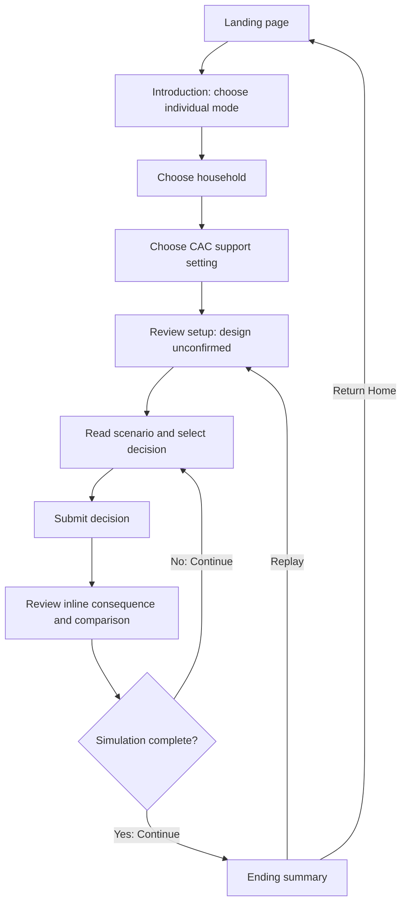
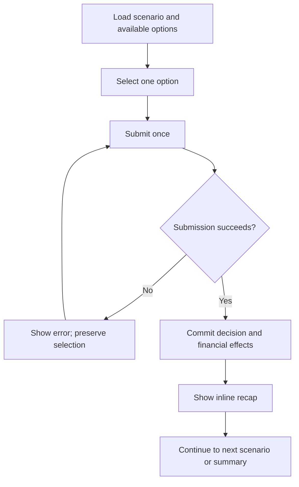

# CAC Poverty Simulation — User Flows

## Specification use and scope

Use [UI specification](./ui-spec.md) for screen components and visual states. This document defines the sequence of user actions and resulting state changes. Agents can use both specifications without external visual references.

**Flow** describes a documented journey; **planned** identifies functionality in project scope; **proposed** identifies behavior requiring team approval. Example values are fictional. Sprint 1 prioritizes individual play; group and administration flows are later scope unless the iteration plan says otherwise.

## User roles

| Role | Journey | Access |
| --- | --- | --- |
| Individual player | Choose a household and support setting, make decisions, review outcomes | Public; no player sign-in screen is specified |
| Group host | Create and facilitate a shared session | Planned; access requirements unconfirmed |
| Group participant | Join a host's session and respond to timed decisions | Planned; join interface unconfirmed |
| CAC administrator | Sign in and manage simulation content | Authenticated and authorized staff |

## Individual simulation journey

The replay-to-Review path is proposed. Review is identified in the setup indicator but its layout and start action remain unspecified. Completion criteria beyond the displayed Day 30 must be resolved in the simulation rules.

### Setup transitions

| Starting state | User action | Result | State effect |
| --- | --- | --- | --- |
| Landing | Play Simulation | Introduction | Enter setup |
| Introduction | Choose Play Individually, then Continue Individually | Household selection | Store individual mode |
| Household | Select one valid profile, then Continue | CAC support selection | Store persona identifier |
| CAC support | Select With/Without CAC Support, then Continue | Review | Store support setting |
| Review | Start action, label unconfirmed | First applicable scenario | Initialize household finances, schedule, and run state |
| Setup step | Back | Previous setup step; Introduction returns home | Proposed: retain selections |

**Proposed validation:** Continue requires a valid selection. A highlight must correspond to the stored choice. Confirm preselection defaults before implementation. Starting initializes once and uses approved persona/scenario content rather than demo figures.

## CAC support journey

1. Explain that support-enabled scenarios may offer assistance, subject to eligibility and availability.
2. Store whether the player chose with or without support before the run starts.
3. With support, include approved assistance options in applicable scenarios. Without support, exclude those opportunities.
4. If the player selects a support option, apply only the approved effect for that scenario. Support selection alone does not grant cash or assistance.
5. Record actual support use separately from availability so the ending summary can show “available, not used” when appropriate.

Changing support during an active run is not specified. It requires an explicit team decision; do not reinterpret earlier choices automatically.

## Decision and recap journey

1. Show day, scenario, current balance, and available options. Upcoming-expense/progress indicators are planned additions whose placement is unconfirmed.
2. Selecting an option changes its selection state; it does not yet change household finances or anonymous response counts.
3. Submit Decision applies the approved scenario outcome and records the choice under the correct question. Prevent duplicate commits from repeated clicks or retries.
4. Update the balance, relevant circumstances, and any scheduled effects according to the simulation rules. Do not invent new financial formulas or branching logic in the UI.
5. Display the inline recap beneath the decision cards, retaining the selected card. It shows the chosen decision, consequence, balance before, immediate cost, balance after, projected balance after upcoming expenses, and circumstance change.
6. Display a relevant approved comparison if available. The consequence remains readable without a comparison.
7. Continue Simulation advances using the defined scenario order/branch and day schedule. It does not apply the same decision a second time.

**Illustrative example:** A $980 balance and a $90 transit cost produce an $890 balance after the choice. The displayed $55 after upcoming expenses is a projection; the underlying expense records and their payment timing must be defined in the simulation rules. These numbers illustrate UI meaning rather than seed production data.

**Proposed:** A committed decision becomes read-only until Continue. On a failed submission, preserve the choice and show an error; only show Decision Recorded after confirmed success. Retry behavior must align with the API's handling of duplicate requests.

**Open:** Back to Review is included on the decision screen. Its effect on an active run, including whether it permits edits or restarts, requires team agreement.

## Comparison journey

The post-decision comparison is a planned addition to the inline recap.

1. Retrieve approved statistics linked to the current question.
2. Present a short relevant figure with its value, unit, geography, data period, and source.
3. Keep player choice/consequence, anonymous player responses, and U.S./Atlanta-area statistics explicitly labeled and separate.
4. If anonymous responses are shown, use aggregated option counts or percentages for the correct question. Do not present them as representative population research.
5. If no relevant approved figure exists, omit that comparison or show a clear unavailable state; never substitute a fabricated value or stop gameplay.
6. At completion, show only comparisons with compatible metrics and units. The prototype's ending bars have no approved quantitative definition.

Do not infer that selecting an option means a player belongs to a real-world demographic group. Anonymous response handling must follow the team's data/privacy specification.

## Completion and replay

**Flow:** The summary shows Day 30, days navigated, ending balance, an important decision, support availability/use, comparison context, and educational next steps.

| Action | Destination/effect | Status |
| --- | --- | --- |
| Donate to CAC | CAC-approved donation destination | Specified action; exact URL unconfirmed |
| Visit CAC Site | CAC-approved information destination | Specified action; exact URL unconfirmed |
| View Data Visualization | Further comparisons | Specified action; destination and metrics unconfirmed |
| Replay Same Scenario | Proposed: Review with the same persona and support setting; starting creates a fresh run | Action specified; reset behavior needs approval |
| Replay Without CAC Assistance | Proposed: Review with the same persona and support disabled; starting creates a fresh run | Action specified; reset behavior needs approval |
| Return Home | Landing page | Specified action |

A replay must not carry over the previous ending balance, decision history, expense payments, or circumstances. Whether it uses the original or latest published content version is a data-model decision. Resolve any alternative ending condition, such as insufficient funds, before implementation; the current flow defines completion at Day 30; early termination remains unspecified.

## Group play — planned, incomplete specification

The introduction displays Host a Group and Join a Group. Prior project scope includes host codes, timed choices, and a debrief, but their detailed interfaces remain unspecified.

| Role | Planned sequence | Details requiring approval |
| --- | --- | --- |
| Host | Select Host a Group → create session/code → participants join → begin and facilitate timed decisions → debrief | Host controls, setup choices, shared household/state, timer rules, end-session behavior |
| Participant | Select Join a Group → enter code → wait/join active session → submit choices → view results/debrief | Code validation, late joining, timeout behavior, reconnects, whether each participant has separate finances |

This is an outline rather than an implementation-ready group specification. Provide approved screens and synchronization rules before assigning group implementation.

## Employee administration — later scope

1. From the public header, select Employee Admin to open sign-in.
2. Enter work email and password, then Sign In. Validate required fields and authenticate through Supabase Auth.
3. Check staff authorization before granting access to content or mutations. A successful login alone is insufficient.
4. Open the content dashboard. Statistics is the initial tab; Scenario Questions is another entry point whose contents are unconfirmed.
5. Inspect records, their display locations, publication status, and last-updated dates.
6. Planned: create/edit/review/publish approved content. Forms, action sequence, and validation remain unspecified.
7. Delete is an interface action, but confirmation, referenced-record protection, and version handling must be defined before implementing it.
8. Main Site returns to the public site. Sign Out ends employee authentication and prevents further protected access.

The dashboard copy says changes affect newly started simulations. Coordinate publication with the content-version design so an active run does not silently mix incompatible content. Remove sample-credential instructions in production.

## Exceptions and recovery — proposed unless stated otherwise

| Condition | Required or proposed user-visible response | Unresolved dependency |
| --- | --- | --- |
| Missing setup selection | Keep Continue unavailable and identify the required choice | Confirm default selections |
| Persona/scenario content fails to load | Show explanation and Retry; prevent advancing with incomplete content | API loading/error contract |
| Decision submission fails | Preserve choice; show retryable error; do not show successful recap | Duplicate-safe submission contract |
| Comparison is missing | Continue gameplay without invented data | Approved-statistics linkage |
| Aggregate response count is zero | Show no responses available; avoid division by zero | Aggregation definition |
| Refresh/session loss | Recover only if supported; otherwise explain and offer a new start | Persistence/resume policy unconfirmed |
| Balance is insufficient or negative | Follow approved simulation rules; show clear financial consequences | Borrowing/affordability/ending rules unconfirmed |
| Invalid employee credentials or denied access | Show readable failure; keep protected content inaccessible | Security specification |
| User leaves a run | Exact warning, retention, and restart behavior require approval | Navigation/persistence policy |

## Team review and verification

Before implementation, resolve the Review screen, defaults, Back to Review behavior, financial/day advancement and ending rules, resume policy, replay version policy, chart metric/destination, group flows, and admin editor/publication/deletion behavior. These decisions should be made by the team and recorded in the appropriate specification.

Verify that a player can complete setup, return through setup without losing choices, play with each support setting, submit each applicable option once, review consequences before advancing, continue when statistics are absent, reach an accurate summary, and replay with a fresh state. Check failure recovery, keyboard navigation, and narrow-screen use. For later admin work, check authenticated authorization and sign-out. These are review scenarios, not claims that implementation or tests have already passed.
